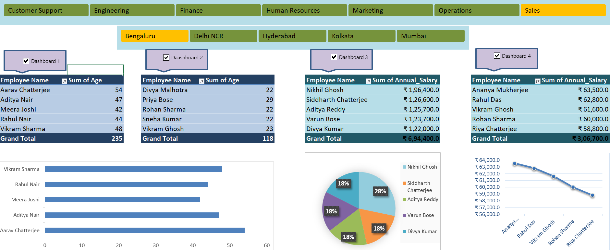

# 📊 HR Analytics Data Analysis Dashboard


-orange?style=for-the-badge)


An interactive **Human Resources & Workforce Analytics Dashboard** built in Microsoft Excel. This project transforms raw employee records into an executive-ready, sliceable visual interface using **PivotTables**, **interactive Slicers**, **dynamic Charts**, and **VBA Macro controls** to analyze employee demographics, departmental headcount, and annual compensation across major Indian tech hubs.

---

## 🔗 Quick Project Links

* 📂 **Dataset & Macro Workbook:** [HR_Analytics_Dashboard_Dataset.xlsm](https://github.com/Destroyer-sword/excel-data-analysis-dashboard/blob/main/HR_Analytics_Dashboard_Dataset.xlsm)
* 🖼️ **Full Dashboard Preview:** [Screenshot (5).png](https://github.com/Destroyer-sword/excel-data-analysis-dashboard/blob/main/Screenshot%20%285%29.png)
* 🌐 **Repository:** [Destroyer-sword/excel-data-analysis-dashboard](https://github.com/Destroyer-sword/excel-data-analysis-dashboard)

---

## 📸 Live Dashboard Preview



---

## 🔍 Detailed Breakdown of the Dashboard View

In the dashboard snapshot above (filtered dynamically for **Department: Sales** and **Location: Bengaluru**), the interface is organized into three synchronized layers:

### 1. Interactive Top Slicers (Multi-Dimensional Filtering)
* **Department Slicer (Top Row):** Horizontal button bar covering **Customer Support**, **Engineering**, **Finance**, **Human Resources**, **Marketing**, **Operations**, and **Sales** *(currently active in gold)*.
* **Location Slicer (Second Row):** Regional filter bar spanning **Bengaluru** *(currently active in gold)*, **Delhi NCR**, **Hyderabad**, **Kolkata**, and **Mumbai**.
* Selecting any combination of Department and Location updates all underlying PivotTables and charts simultaneously.

### 2. Macro-Enabled Dashboard Modules & PivotTables
Four modular PivotTable views (`Dashboard 1` through `Dashboard 4`), each paired with interactive form-control checkboxes (`Dashboard 1` – `Dashboard 4`), summarize key workforce segments:
* **Dashboard 1 — Senior Workforce Age Distribution (`Sum of Age`):** Lists senior team members (*Aarav Chatterjee: 54, Vikram Sharma: 48, Aditya Nair: 47, Rahul Nair: 44, Meera Joshi: 42*) with a combined age total of **235**.
* **Dashboard 2 — Early-Career Cohort Age Breakdown (`Sum of Age`):** Tracks younger/junior talent (*Priya Bose: 29, Vikram Ghosh: 23, Divya Malhotra: 22, Rohan Sharma: 22, Sneha Kumar: 22*) with a combined age total of **118**.
* **Dashboard 3 — Top Compensation Tier (`Sum of Annual_Salary`):** Highlights higher-earning employees in INR (*Nikhil Ghosh: ₹1,96,400.0, Siddharth Chatterjee: ₹1,26,600.0, Aditya Reddy: ₹1,25,700.0, Varun Bose: ₹1,23,700.0, Divya Kumar: ₹1,22,000.0*), totaling **₹6,94,400.0**.
* **Dashboard 4 — Mid/Entry Compensation Tier (`Sum of Annual_Salary`):** Displays compensation across the next employee cohort (*Ananya Mukherjee: ₹63,500.0, Rahul Das: ₹62,800.0, Vikram Ghosh: ₹61,600.0, Rohan Sharma: ₹60,000.0, Riya Chatterjee: ₹58,800.0*), totaling **₹3,06,700.0**.

### 3. Synchronized Data Visualizations (Bottom Row)
* **Horizontal Bar Chart (Left):** Visualizes employee age comparison from **Dashboard 1**, making it easy to spot the most experienced team members at a glance.
* **Percentage Pie Chart (Center):** Breaks down the top salary share from **Dashboard 3**, clearly showing **Nikhil Ghosh** holding the largest share (**28%**) while the remaining four peers hold **18%** each.
* **Salary Trend Line Chart (Right):** Plots the descending compensation curve across **Dashboard 4** from **₹63,500.0** down to **₹58,800.0**.

---

## 🛠️ What I Built & Workflow Summary

1. **Data Preparation & Structuring:** Cleaned and structured employee HR records (Employee Name, Department, Office Location, Age, and Annual Salary in `₹`) in the source worksheet.
2. **PivotTable Modeling:** Created **4 independent PivotTables** to segment employee age groups and compensation tiers without altering raw data.
3. **Interactive Slicer Architecture:** Connected **2 horizontal multi-column Slicers** (Department & Location) across PivotTables for one-click cross-filtering.
4. **VBA & Form Control Integration:** Added checkbox controls (`Dashboard 1`–`Dashboard 4`) and macro support (`.xlsm`) to manage dashboard view states.
5. **Visual Design & Formatting:** Styled headers, currency formatting (`₹`), callout badges, and three distinct chart types (Bar, Pie, and Line) for fast executive readability.

---

## 🚀 How to Run This Workbook Locally

<details>
<summary><b>Click to expand step-by-step instructions</b></summary>

1. **Clone the repository** or download the `.xlsm` file directly:
   ```bash
   git clone [https://github.com/Destroyer-sword/excel-data-analysis-dashboard.git](https://github.com/Destroyer-sword/excel-data-analysis-dashboard.git)
